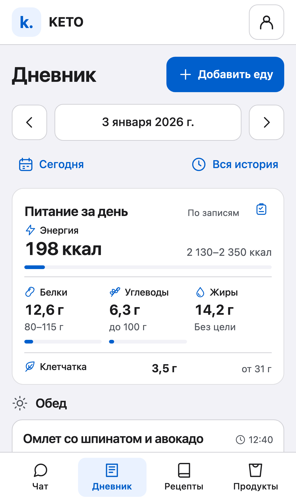
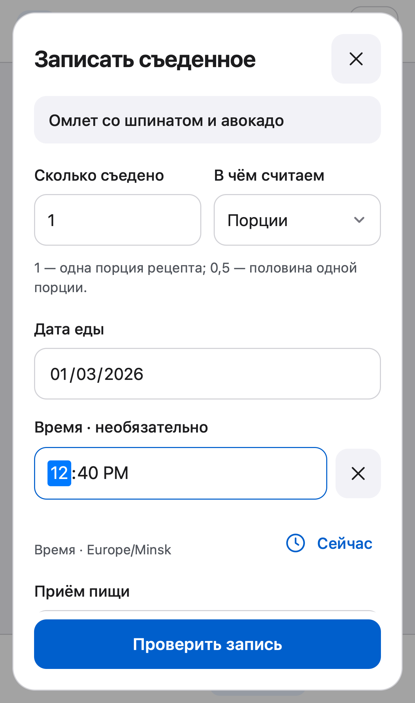

# KETO C16 — дневник, мобильные формы и Animate UI

## Текущее состояние

Сервер Azure обновлён до `c2b5d20a1a1aabcf6bf25d43c7e37f39f614e504`; фактически загруженные Python-файлы подтверждены контрольной суммой. Образ Cloudflare принят. Финальная обычная публикация основного Worker запущена; до её успешного завершения этот документ не утверждает, что новый интерфейс уже опубликован.

## Что исправлено

**Модальные окна и поля.** Дата и время ограничены шириной контейнера, нативные WebKit-поля нормализованы, горизонтальное переполнение устранено. Вертикальная прокрутка сохранена. Поля заметки и выбора времени при переходе часов доступны над закреплённой кнопкой даже при высоте 420 px. Очистка необязательного времени сбрасывает внутренний нативный редактор: в WebKit ранее возникало событие invalid при одновременно истинном validity.valid. Валидация формы и сервера сохранена.

**Где видно съеденное.** Дневник показывает дату, итоги за день и карту приёмов пищи. В записи видны блюдо, порция, время и известные нутриенты; доступны исправление, повтор и удаление. Подтверждение сервера сразу добавляет запись и обновляет итог. Если последующая загрузка истории не удалась, подтверждённая запись остаётся на экране. Запись за пределами первой страницы закрепляется отдельно, не смещая пагинацию и не создавая дубликатов.

**Что считается.** Сумма берётся по всему выбранному дню, включая записи вне текущей страницы. Сравнение использует только актуальные согласованные цели. Для неполной этикетки показывается известная часть, а не вымышленный ноль или точный процент. При устаревших целях или приостановленных рекомендациях прогресс не подменяет действующую рекомендацию. Жиры показываются как съеденное количество без придуманной нормы. Пустая история не доказывает отсутствие еды.

**Рецепт и съеденная порция.** Сохранение рецепта или продукта в каталог завершается отдельным действием «Записать порцию». Добавление в каталог само по себе не записывает употребление. Без подтверждённого часового пояса дневник можно просматривать по явно обозначенному времени устройства; для записи времени требуется явное подтверждение зоны. При этом черновик выбранного блюда и порции сохраняется.

**Память ассистента.** В контекст поступают сохранённые подтверждённые факты профиля, предпочтения, дата исходных измерений и серверный итог запрошенного дня. Список блюд ограничен десятью названиями, но расчёт охватывает все записи. Забытые предпочтения и сырой текст заметок не возвращаются в профильную память. Обсуждение дня дополняет черновик чата и не отправляет его автоматически. Существующие подтверждения, изоляция аккаунтов и управление согласием сохраняются.

## Компоненты Animate UI

Использована официальная адаптация для обычной разметки и CSS из v2.4.3, commit `22a9236ae107328f8564edb7e3299375da3247af`: Dialog, Accordion/Collapsible, SVG Check и параметры отклика кнопок. Это адаптация конкретных исходников и motion tokens, а не установка React-компонентов в существующее vanilla-приложение.

Появление окна — 220 ms; раскрытие деталей — 350 ms при поддержке браузером; подтверждение сохранения рисует галочку за 300 ms. Закрытие остаётся немедленным, чтобы фокус и навигация не ожидали анимации. При reduced motion управление и финальная галочка остаются видимыми, движение отключается. Полная лицензия MIT + Commons Clause и источники сохранены в vendor/animate-ui. Фото и дополнительные React/Motion-зависимости не добавлялись.

Официальные примеры MyFitnessPal, Cronometer и MacroFactor использованы для порядка «дневной итог → приёмы пищи → детали», ясного отображения целей и истории. Документация временных полей и Playwright проверена через Context7. Источники и решения: [C16 design](../design/C16_DIARY_AND_MOTION.md).

## Проверка

- 639 Python-тестов и 6 подтестов; 260 JavaScript-тестов.
- 22 браузерных сценария: 11 в Chromium и 11 в WebKit, с настоящим HTTP/SQLite на синтетических аккаунтах.
- Ширины 360/390/402/430 CSS px, экран 402×681 при DPR3, уменьшенная высота 420 px, обычная и уменьшенная анимация.
- Полная облачная проверка из 16 этапов; 12 проверок выпуска.
- Реальный изолированный контейнер: syntax/build успешно, 14 product и 17 Python-тестов.
- Контракты, ссылки спецификации, чистота пакета и соответствие generated assets проверены.

Скриншоты содержат только синтетические данные:

## Разобранные отказы и продолжение

Ограничение облачной среды запрещало Chromium создавать нужные сокеты. После ограниченной диагностики браузерная проверка перенесена на авторизованный Mac в отдельный checkout; исходный рабочий каталог не заменялся. Все процессы этой приёмки завершились, порт тестового сервера свободен.

Первая native-сборка C16 остановилась до deploy: после регенерации snapshot полный файл app.css превысил существующий 60 000-байтовый предел developer patch. Стили разделены на защищённые модули в прежнем порядке. Итоговые CSS, JavaScript, HTML и legacy bundle остались побайтно идентичны браузерной приёмке. Ограничения сохранены; новый тест проверяет свежесть snapshot и возможность полного ограниченного patch для каждого editable-файла. Ошибочная сборка сохранена отдельно, её результат не заменён успешным.

Первая обычная публикация точного R прошла все 16 source-этапов и 12 ops-тестов, но временный verifier получил HTTP 502 без структурированной квитанции стадий. Точная причина исключения не установлена. Прежний main Worker сохранился; независимое чтение подтвердило отсутствие probe и активных контейнеров. Запущена одна повторная обычная проверка того же коммита и уже принятого образа без пересборки.

Для продолжения записываются точный commit, baseline, image digest, UUID сборки, PID и terminal result. Неопределённая облачная операция проверяется по уже записанному идентификатору; новый образ вслепую не запускается.

## Границы доказательств

Проверка WebKit на Mac с мобильным viewport не является проверкой физического iPhone 17 Pro. Клавиатура, browser chrome, камера/штрихкод/фото, диктовка и свежий вход супруги в этом цикле на физическом устройстве не выполнялись. Личные записи семьи не изменялись для тестов. Подтверждена передача правильного контекста ассистенту и детерминированные ответы; качество нового ответа живой модели не измерялось. Ни браузерные тесты, ни точный digest Azure не заявляются новой подписанной live-транзакцией семейного аккаунта или клинической валидацией.
