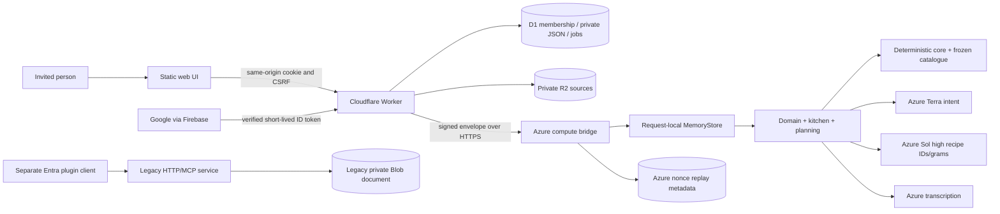

# Architecture

## Components and trust boundaries



[Worker](../../cloudflare-saas/src/worker.mjs) owns public routes and SaaS membership.
[Compute](../../cloudflare-saas/src/compute.mjs) owns admission, locks, jobs and commit checks.
[EdgeBridge](../../service/edge_bridge.py) verifies signed envelopes and invokes the same domain layer.
It uses a request-local store, not the legacy user's durable Blob state.
[Core](../../library/skills/keto-companion/scripts/keto_core.py) owns validated arithmetic/events.
[Store](../../service/store.py) supplies SQLite for local work and Blob CAS for legacy state/replay metadata.

## Authentication sequence

```mermaid
sequenceDiagram
  actor U as Invited user
  participant UI
  participant W as Worker
  participant F as Firebase Google
  participant DB as D1
  U->>UI: Click sign in
  par Challenge
    UI->>W: POST firebase/start (invite)
    W->>DB: Reserve browser-bound challenge
    W-->>UI: transaction + HttpOnly challenge cookie
  and Popup
    UI->>F: Google sign-in from same click
    F-->>UI: fresh ID token
  end
  UI->>W: POST firebase/complete (token, transaction)
  W->>W: verify issuer, audience, Google provider, signature and time
  W->>DB: Consume challenge; resolve exact Google identity and invitation
  W-->>UI: HttpOnly session cookie
  UI->>W: GET api/session
  W-->>UI: own role/status + session-derived CSRF
  U->>UI: Explicit invitation claim if pending
  UI->>W: POST api/invites/claim
  W->>DB: Claim invitation + activate member atomically
```

Source: [firebase-flow](../../cloudflare-saas/public/firebase-flow.js),
[Firebase verifier](../../cloudflare-saas/src/firebase-identity.mjs), Worker.
Popup/SDK sign-out happens in `finally`; the app session is a separate server cookie.
Successful Google authentication alone does not activate an uninvited member.

## Compute, cost and commit sequence

```mermaid
sequenceDiagram
  participant UI
  participant W as Worker
  participant DB as D1
  participant E as Azure bridge
  participant M as Model or local engine
  UI->>W: POST tools/name (arguments, request ID where required)
  W->>DB: Authenticate active member/session
  W->>DB: Reserve pending job + revision + 180s lock + paid quotas
  W->>E: Signed subject/state/operation/arguments
  E->>E: Verify signature/time; reserve nonce once
  E->>M: Validated local computation or bounded model call
  M-->>E: Candidate result
  E-->>W: response + proposed new document
  W->>DB: CAS commit iff lock/revision/session/status/consent still match
  alt Commit accepted
    W->>DB: Complete job, optional refund for model_called=false, unlock
    W-->>UI: response
  else State, consent or session changed
    W->>DB: Fail job; unlock owned lock
    W-->>UI: STATE_CHANGED / explicit failure
  end
```

The request has two revision systems: D1 private-state revision and service document revision.
Domain core adds `state_revision` and profile `profile_revision`.
These are not interchangeable; designers submit the service snapshot revision.

Worker timeouts are 55 seconds to bridge; locks expire after 180 seconds.
The lock lifetime is a concurrency mechanism, not a guarantee that Azure effects finish by then.
Request payload and serialized state/answer limits guard transport size.
A failed upstream request may already have consumed provider work: never automatically replay it.

## Synchronous work, not a background queue

The UI awaits one HTTP result. D1 `jobs` records idempotency/admission;
it is not a worker queue, cron runner or push scheduler.
Deletion advances through explicit `/continue` calls.
Reminders redraw while the page is open; calendar notifications are external after import.
Audio cancellation aborts delivery to the current UI but does not prove upstream cancellation or refund.

## State flow

1. A session determines an internal user ID; body-provided identities are rejected.
2. Worker loads the user's current D1 JSON.
3. Bridge validates ownership and constructs a memory-backed service.
4. Service may prepare a proposal without applying its payload.
5. Apply reloads, checks revision/expiry and revalidates against present safety state.
6. Worker commits the result only if its independent admission fingerprint still holds.
7. UI replaces displayed state through `accept`/`setState`, not by inventing local saved values.

## Frontend module ownership

| Module | Responsibility |
| --- | --- |
| `public/index.html` | Shell, page hosts, forms and dialogs |
| `public/app.css` | Maintained styles and tokens |
| `public/app.js` | Session, call, state renderer, confirmations, cookbook, diary, admin and sources |
| `public/setup-ui.js` | Guided stages, baseline, preview, target fields and knowledge |
| `public/setup-controls.js` | Numeric parsing, step buttons and slider synchronization |
| `public/kitchen-ui.js` | Studio, ingredient controls, candidates, memory view |
| `public/mobile-ui.js` | Voice/photo wiring, topics, reminders, PDF share, viewport |
| `public/media.js` | Recorder lifecycle and image preparation |
| `public/routes.js` | Hash navigation and browser-history contracts |
| `build.cjs` | Generated style/bundle/embedded/distribution assets and manifest |

All paths are under [cloudflare-saas](../../cloudflare-saas/).
The [legacy static UI](../../service/static/index.html) is a separate client and bundle.
Do not replace it with the SaaS UI or use it as the SaaS source of truth.

## Deployment separation

Worker deployment and Azure compute deployment are separate effects.
A compatible bridge contract, current catalogue and private bindings must be checked together.
No D1/R2 recreation or silent state migration is part of a UI redesign.
Reported staging origin: `https://keto-companion-saas-staging.offflinerpsy.workers.dev`.
This public identifier is from the deployment script; this review made no request to it.

## Known architecture limits

- Whole-document JSON and bounded history impose finite storage growth limits.
- D1 and R2 deletion are not one transaction; reservations/retry receipts bridge partial failures.
- Nonce replay metadata is durable; personal compute state is transient at the Azure bridge.
- A chat request may call Terra and then Sol; request count is not a provider invoice.
- No current code path establishes clinical or physical appliance validation.
- See SA07-02 for the gap between keyword-based admission and actual paid recipe dispatch.
