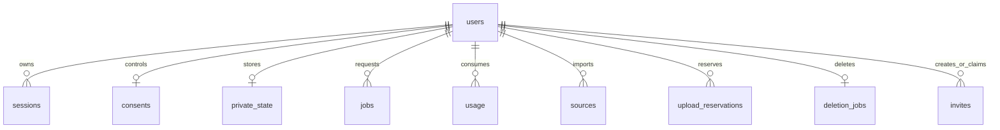

# Data model and lifecycle

Authoritative SQL: [0001](../../cloudflare-saas/migrations/0001_initial.sql),
[0002](../../cloudflare-saas/migrations/0002_integration.sql),
[0003](../../cloudflare-saas/migrations/0003_global_usage.sql),
[0004](../../cloudflare-saas/migrations/0004_firebase_challenges.sql).
This is a readable model, not a replacement migration or a complete machine schema.

## D1 entities

| Table | Key and relationships | Purpose and sensitive fields |
| --- | --- | --- |
| users | `id` PK, `google_sub` unique | Email, admin/member role, pending/active/suspended status; join/activity timestamps |
| sessions | `token_hash` PK → users | Hashed session token; creation/expiry; no raw cookie value |
| invites | `id` PK, unique token hash; creator/claimant → users | Email-bound invitation; expiry, revocation and claim timestamps |
| oauth_attempts | state hash PK | Direct-Google PKCE verifier, nonce/invite hash and expiry |
| firebase_challenges | transaction hash PK | Browser cookie hash, invite/IP hashes, consumed time, expiry |
| consents | user PK → users | storage/health/processing flags, update time and consent revision |
| private_state | user PK → users | Revision, JSON payload, update time, owned lock ID/deadline |
| usage | `(user_id,day)` PK | Per-member daily request counter |
| global_usage | day PK | Aggregate daily admission counter |
| jobs | `(user_id,request_id)` PK | Request hash, status, admission revision/consent revision, response cache and finish time |
| sources | id PK → users | Provenance, excerpt, status, rights acknowledgement, optional private object key/MIME |
| upload_reservations | id PK → users | Unique object key and pending/cleanup status for partial R2 effects |
| deletion_jobs | user PK → users; receipt hash unique | Pending/complete deletion and timestamps |
| audit | id PK | Actor/action/target metadata; no diary content contract |

`private_state.payload` is private per-user JSON inside D1, not a public asset.
Source records and metadata can contain personal information even without a diary.
Indexes support owner lookups, session ownership, invitations and challenge cleanup.
Foreign-key cascades exist on several child tables; actual account deletion uses explicit cleanup.

## Identity representation

Worker derives `u_` plus a SHA-256 representation of the verified Google subject.
Firebase verification resolves the single Google provider identity rather than accepting an arbitrary Firebase UID.
Email must be verified and must match membership/invitation requirements.
Do not expose generated user IDs, tokens, sessions or real membership records in design fixtures.
Legacy Entra subject mapping is a separate allowlist, not a lookup into SaaS users.

## Service wrapper document

Defined by [new_document](../../service/domain.py) and migration helpers in
[mobile](../../service/mobile.py) and [kitchen](../../service/kitchen.py).

| Field | Meaning |
| --- | --- |
| schema | Service wrapper schema `2` |
| revision | Service revision used by UI mutation commands |
| core | Deterministic `keto_state` document |
| ui | Theme, text size, density, simple mode, home and nutrition visibility |
| ui_history | Last 30 UI changes; snapshot exposes last 8 |
| pending | Up to 12 proposals with base revision, expiry, status and payload |
| receipts | Last 120 proposal receipts; not full medical audit retention |
| processing_consent | Service-side model processing permission |
| holds | Persistent safety signals; not silently cleared by UI |
| requests | Last 150 conversational request records |
| chat | Compatibility copy of main-topic messages |
| topics | Personal bounded topic map; each has title/messages/choices and optional kitchen group |
| active_thread | Existing selected topic ID |
| reminders | Up to 20 personal reminder objects |
| kitchen | Pantry, shared preferences, drafts, request receipts, ratings and accepted history |
| guidance_choices | Confirmed goal/mode separate from free-text goal |
| targets_provenance | Manual or starter-policy origin, calculation fingerprint and applied metadata |
| usage | UTC daily calls/tokens and role subtotals |
| audio_requests/audio_usage | Legacy service transcription receipts/counter; no raw audio or transcript |

A service save compacts topic history and rejects serialized state above 1,400,000 bytes.
The store has a separate 2,000,000-byte serialization ceiling.
Worker state/answer admission uses 1,500,000 bytes; bridge output reading caps at 2,000,000.
These nested limits describe different transport/state boundaries, not extra available memory.

## Core state

[Core engine](../../library/skills/keto-companion/scripts/keto_core.py) defines:

- Schema `1`, kind `keto_state`, owner and subject identities.
- `state_revision`: each accepted event; separate from service and D1 revisions.
- `profile`: screening, baseline, consent, medication list, allergies, targets and settings.
- `diary`, `feedback`, `checklists`, `plans`.
- `events`: event IDs/types/times; `event_receipts`: event hash/revision for idempotency.
- `custom_foods`, `custom_recipes`: personal extensions, never overwrites of base IDs.
- `settings_history`, `change_proposals`, `integration_receipts`.

Profile changes increment `profile_revision`; earlier accepted plans become stale.
A display-name-only service change has a narrow preservation path for prior accepted plans.
Do not generalize that exemption to allergies, targets, settings or baseline changes.

## Catalogue and nutrition semantics

Base foods: [foods.json](../../library/skills/keto-menu/data/foods.json).
Base recipes: [recipes.json](../../library/skills/keto-menu/data/recipes.json).
The inspected files contain 85 foods and 72 recipes; new releases must recompute counts/hashes.

A food row includes exact identity, language names, state, group, allergens,
source provenance and nutrient values per 100 g edible material.
FoodData Central rows carry FDC/source IDs and retrieval metadata.
Missing values are `null`; an explicit numeric zero is different.
Recipe ingredients carry `food_id`, `grams_edible` and exact food state.
`base_servings` describes batch yield in portions; scaling a recipe divides by it.
Raw and cooked records are not interchangeable weights.

A calculated result includes `nutrition`, `coverage`, allergen union and ingredient detail.
Coverage identifies complete values, known subtotals and missing food IDs.
Missing any ingredient value makes the corresponding total unknown.
Net carbohydrate is recomputed from total carbohydrate minus fiber only when both are complete.
See [nutrition rules](NUTRITION_RULES.md) for formula/limits and source interpretation.

Custom foods require a `U` ID, confirmed label, source reference and normalized total-carb basis.
Custom recipes require an `R` ID, known ingredients, explicit confirmation and bounded fields.
Kitchen drafts use deterministic `RK…` IDs derived from policy/raw candidate content.
Validated custom recipes retain `kitchen_tested=false` and `clinical_validated=false`.
Catalogue hashes include personal extensions and invalidate incompatible plan approvals.

## Kitchen state

- Pantry rows: exact ID/state and optional known grams; maximum 30 rows.
- Preferences: ID, food IDs, text, added dislike IDs, explicit-confirmation origin and timestamp.
- Drafts: up to 30 validated recipes and method/origin metadata.
- Requests: up to 100; full responses only retained for the last three entries.
- Ratings: bounded to 30; accepted recipe history bounded to 30.
- Topic group: spec, candidate IDs, selected ID and creation time.
- `facts_changed_at`: suppresses older context after remember/forget.
- `plan_pantry`: snapshots for last eight accepted kitchen plans.

A draft selection updates working context; it does not accept a meal, log food or consume stock.
A kitchen diary action can save a referenced personal recipe before logging its confirmed fraction.
A day save adds all candidate recipes, builds a current plan and then accepts it.

## Source record lifecycle

1. A rights-attested URL alone becomes `needs_content`; no claim of reading it.
2. Pasted text or an upload becomes `draft`.
3. Explicit review changes draft to `reviewed`.
4. Confirmed recipe import can mark its source `personal_recipe`.
5. Source deletion removes its object and metadata; it does not inherently remove previously saved recipe text.

Text excerpt length is 2,000 characters; a text upload is at most 4,000 bytes.
Upload types are JPEG, PNG and text/plain, with 512,000-byte input limit.
Sanitized images are JPEG, capped separately at 1,000,000 bytes.
Private keys use the owning `private/<user>/` prefix; no public object listing API exists.

## Forgetting and retention

Topic clear/delete removes message history, relevant request replies, accepted topic quotes
and orphan draft references. Shared preferences, profile, pantry and saved recipes remain.
Forget preference removes its owned exclusion while preserving overlapping or pre-existing exclusions.
Consent revocation is a processing/storage stop, not a promise of erasing all prior diary data.
JSON export and explicit account deletion are separate controls.

Deletion start suspends the account, removes sessions, bumps state revision and fails pending jobs.
Continuation waits for in-flight uploads, retries R2 cleanup and removes private D1 collections.
It leaves a suspended pseudonymized user/tombstone and deletion receipt status.
Backups/object versions follow a separate policy; no immediate universal erasure claim is implemented.
An unfinished upload reservation can keep deletion pending until reconciled.

## Versioning invariants

- Never replace a current document with an old export without validation and consent.
- Never compare UI `revision` to D1 `revision` as if they were the same counter.
- Never turn missing nutrient data into zero during import, migration or rendering.
- Preserve source/catalogue/profile hashes across accepted menu comparisons.
- Exported private JSON is not a public delivery asset.
